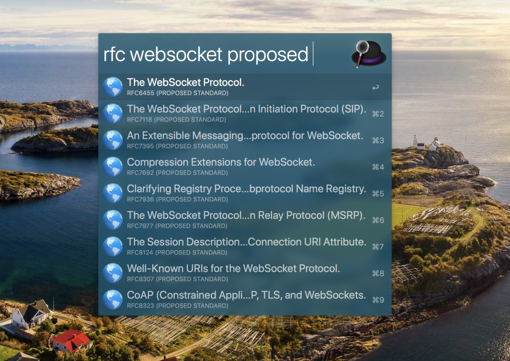
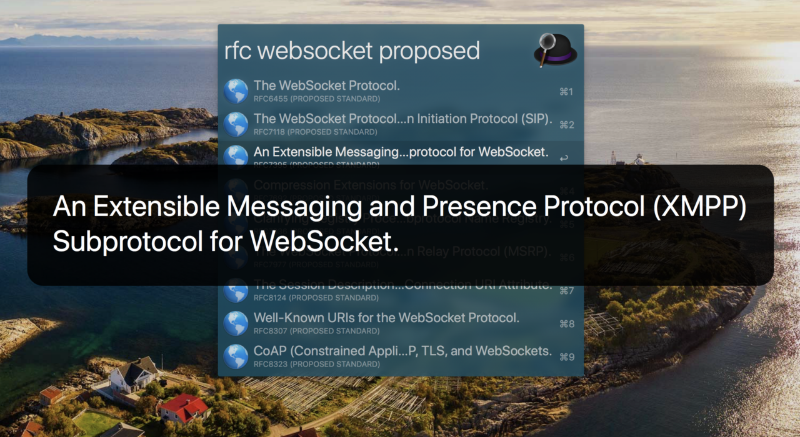

# Alfred RFC

Search the RFC Editor index offline in Alfred or from the command line.

## Installation

Open [SearchRFCs.alfredworkflow](SearchRFCs.alfredworkflow) in Alfred with Powerpack enabled. The workflow uses Python 3.9 or newer and bundles its RFC index.

Type `rfc` followed by a number or keywords, such as `rfc 9110` or `rfc quic transport`.

## Screenshots

* Search by keywords, `Enter` to open in browser

* `⌘+L` show full title detail

* `⌘+c` copy link
* `⌘+y` quick view the link without open it in browser

